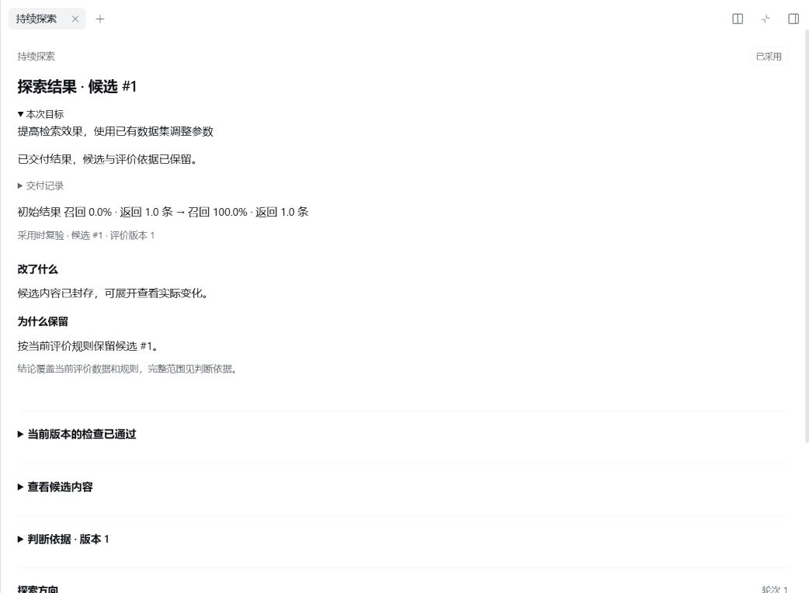

# DSH SLA · 持续探索

**给项目一句改进目标，让它调查、尝试、比较，把更好的结果交给你。**

DSH SLA 是 DeepSeek Harness 的社区插件。你不必先写好实验方案和评估脚本：描述希望改进的地方，插件会调查项目、建立判断依据，沿不同方向持续尝试。你可以随时补充要求，最后查看结果与改动，决定是否采用。

> 让这个项目在大数组上运行得更快，保持现有行为，不增加依赖。



检索参数示例的探索结果。

## 先试什么

| 你想做的事 | 可以这样开始 |
| --- | --- |
| 优化代码性能 | “让大数组去重更快，保持输入顺序和现有行为。” |
| 修复缺陷 | “修复 clamp(0, -5, 5) 错误返回 -5 的问题，保持其他行为。” |
| 调整检索参数 | “利用已有评测集改善检索效果。” |

代码任务会给出可采用的改动；内置检索参数示例会交付 JSON 参数包。[使用指南](docs/usage.md)带你从一个小项目跑通完整过程。

## 安装

需要 **DeepSeek Harness 0.2.1-rc.2、Node.js 24 和 Git**，并已在 Harness 配置模型：

```sh
dsh plugin --profile web add dsh-sla@0.4.1
dsh web
```

已有服务请重启并刷新页面。在项目中新建会话，选择 **持续探索 · SLA**，发送目标。使用其他 profile 或需要卸载，见[安装说明](docs/install.md)。

## 在探索中保持掌控

- **看结果再采用**：面板展示当前候选、实际检查和文件改动。采用前再次复验，项目已有新改动时停止覆盖。
- **随时调整方向**：直接在对话里补充要求，也可以暂停、继续或调整探索额度。
- **让尝试积累下来**：每个方向保留自己的候选和反馈，下一轮可以接着做；失败也会成为规划依据。

模型用量在 DSH 中查看。代码工作流优先适合无依赖或依赖由系统提供的小型项目；如何选择任务、调整额度和处理停顿，见[使用指南](docs/usage.md)。

## 加入自己的工作流

方法指引用 DSH Skill，领域流程用普通 DSH 插件。SLA 提供统一注册入口，可复用代码工作流，也可定义自己的制品、评价与交付方式。

插件实现、测试和工程脚本均使用严格 TypeScript，发布可直接运行的 JS、同源类型声明和 source map。源码开发先执行 `npm ci`、`npm run build`；扩展可从 `dsh-sla/workflow` 导入类型，运行时无需 TypeScript。

[扩展开发](docs/extensions.md) · [架构](docs/core.md) · [参与开发](docs/development.md)

设计受 Stateless Language Agents 启发。[论文与实现范围](docs/research.md) · [发布验证](docs/validation.md) · [MIT License](LICENSE)
