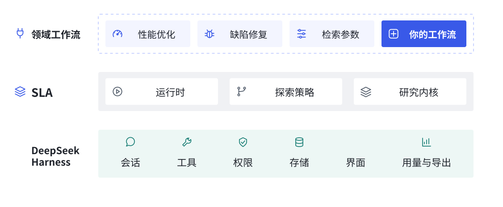
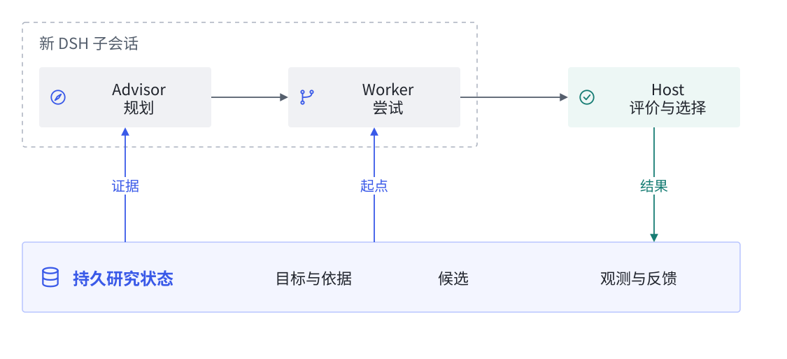
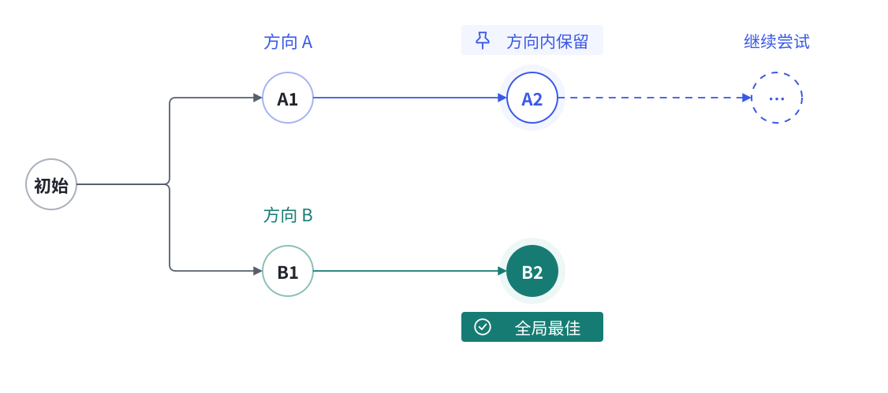

# 架构：持久研究状态与领域工作流

SLA 将运行状态保存在模型会话之外。每次角色调用创建新的 DSH 子会话，输入由目标、候选和已保存证据组成。运行时管理生命周期，领域工作流组合探索策略、评价与交付。

工作流决定怎样准备、评价和交付；SLA 策略组织搜索，内核保存共有事实。接入方式见[扩展开发](extensions.md)。

## 为什么这样拆分

一次尝试做什么，由领域决定；怎样记住已做的尝试、比较候选并接着推进，是探索系统共有的问题。内核只保存这些共有事实，工作流把它们组合成具体任务。

例如，性能任务的制品是代码快照，参数任务的制品是 JSON。二者都需要一次可信观测来支持保留决定，但准备方式、评价方法和交付方式各不相同。扩展这些领域行为时，不需要让内核理解文件差异、性能单位或检索指标。

## 模块边界

| 层 | 当前职责 | 源码 |
| --- | --- | --- |
| DSH 宿主适配 | 复用会话、工具、权限、存储、界面、用量和日志 | `src/host.js`、`src/researcher.js` |
| 运行时 | 启停、调用、时间与尝试额度、持久化恢复 | `src/runtime.js` |
| 探索内核 | 尝试身份、制品、观测、选择与评价版本 | `src/kernel.js` |
| SLA 策略 | 多方向、局部候选、Epoch 接续和全局保留 | `src/sla-strategy.js` |
| 领域工作流 | 准备、评价、审查、制品校验和交付 | `src/code-workflow.js`、`src/native-workflow.js`、`extensions/` |

## 一次探索

上图展示默认搜索流程中的角色与状态关系。调用使用新的 DSH 子会话，接续所需的候选与证据由运行时重新提供。

1. 调查目标与项目，选择已注册工作流。
2. 建立初始制品和判断依据，实际运行基线。
3. Advisor 读取各方向证据，安排本轮尝试。
4. Worker 从该方向保留的制品继续。Host 独立评价，记录失败或结果，再决定保留。
5. 本轮结束后可继续探索；用户选择采用时复验并交付。

每次尝试先持久化身份和额度，再调用工具。调用中断与评价失败分别记录；没有评价的改动不能成为下一次尝试的起点。并行 Worker 尚未实现。

## 评价与候选

制品有内容身份；观测绑定制品和评价版本；选择引用实际观测。结果可以是数值、状态或结构化领域信息。`compare` 判断更好、相等、更差或不可比较，`qualify` 区分可继续研究与可交付。

每个方向保留局部候选，允许暂时落后于全局最佳。下图中，B2 是全局最佳，方向 A 仍从自己的 A2 继续尝试。

各方向的尝试按序执行。未保留的尝试也会留下观测与反馈，供后续规划使用。

评价升级先重测初始制品及保留候选，全部完成后发布新排序。历史测量保持原版本，不能被当作新规则下的结果。

代码工作流在建立依据和采用前检查遗漏的保留行为；补充检查必须通过初始项目，才可以据此判定候选回归。评价文件整个 `.sla/` 目录被冻结，检查不能改写候选或自己的依据；临时缓存可用检查副本的 `.dsh/cache/`。

## 暂停、恢复与交付

暂停会取消并等待正在执行的调用。重启后活动探索转为暂停，已完成尝试保留；继续时接续未完成分配。探索绑定工作流 id/version，缺失或版本变化时停止继续执行，避免替换该探索的判断规则。

代码采用复验最佳候选，核对初始文件清单与内容，写入前再次核对路径与本地改动。交付中断保留日志并核对已发生的副作用。自定义工作流返回 delivered / absent / unknown，unknown 状态保持等待核对，不能直接重试。

首发存储使用 `sla_runs` 域、格式 1；本地开发期记录保留在原数据域，生产代码不读取或迁移它们。

## 运行条件

- 默认 8 次尝试 / 20 分钟；每 Epoch 最多 2 方向，每方向 2 次局部尝试。每次调用 24 工作步和 1 提交步，共用 5 分钟上限。所有调用受整轮剩余时间约束。
- 文件快照上限 100 MiB / 15000 文件；跳过 Git 忽略项、依赖/构建目录、`.dsh` 和 `.env`，遇到符号链接停止。项目 Skill 放在 `.agents/skills`。
- 代码工作流不复制依赖安装目录，不提供进程读隔离或网络隔离。扩展是可信的 DSH Host 代码，必须遵守取消信号和权限。
- 判断依据由模型和领域扩展建立，用户可在面板查看实际检查范围，并补充约束触发复验。

实际覆盖见[验证结果](validation.md)。
