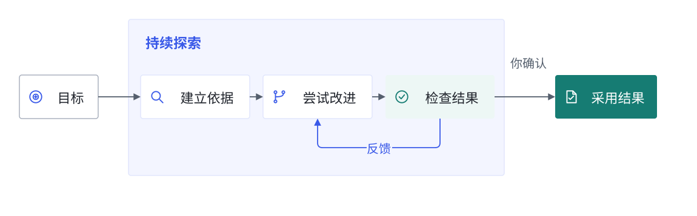

# 第一次持续探索

先用一个小而完整的项目体验：描述目标，观察一次改进，再决定是否采用。插件负责调查项目和建立检查，你负责表达希望得到什么结果。

## 修复一个小缺陷

按[安装说明](install.md)取得示例，复制 `examples/clamp-bug` 为工作区。在 Harness 新建会话，选择 **持续探索 · SLA**，发送：

> 修复 clamp(0, -5, 5) 错误返回 -5 的问题，保持其他行为，不增加依赖。

插件会检查项目、复现缺陷、尝试修复，再运行回归检查。点击会话顶部的 **探索** 打开面板，可以看到当前结果、检查与改动。

查看 **改了什么** 和 **为什么保留**，展开候选文件差异。满意后点击 **采用这个结果**；插件会再次检查，并把代码写回工作区。

## 换成自己的目标

目标可以从一句话开始。已知约束直接一起说出来，例如“保持返回顺序”“不要增加依赖”“只改解析模块”。评价脚本和尝试方向交给插件调查。

目前附带三个工作流：

- **代码性能**：例如优化 `duplicates-baseline` 的大数组处理。插件建立正确性检查与测量，再比较不同实现。
- **缺陷修复**：例如 `clamp-bug`。先确认缺陷，再尝试修复并检查其他行为。
- **检索参数**：`retrieval-parameters` 提供固定数据和英文词项检索评测器，探索 `topK` 与 `titleWeight`，采用时生成 `parameters.json` 交付包。

代码任务优先选择可以在本机直接检查的小型项目。候选快照不会复制依赖安装目录；大型项目可以先选一个无依赖或依赖由系统提供的子模块。要接入其他任务类型，可以安装或编写[领域工作流](extensions.md)。

## 探索中怎样干预

直接在主对话补充要求，例如：

> 还需要保持自定义迭代器的行为。

插件会保存要求、重建判断依据并重新检查候选。之前的尝试仍保留，面板会区分评价版本。

想稍后再做就点击 **暂停**；点击 **继续**，会沿已保存的方向接着尝试。关闭或重启 Harness 后，活动探索会停在暂停状态，等待你继续。

## 什么时候调整额度

默认每轮最多 8 次尝试、20 分钟；每次模型调用最多 24 个工作步，另有 1 步提交结果，共用 5 分钟。先用默认设置观察任务，再根据实际停顿调整。

在面板的 **探索设置** 中修改尝试数和时间；高级设置可调整单次步数、时间、方向数与局部尝试数。运行中先暂停，保存后继续。也可以直接说：

> 暂停，把每轮上限改成 12 次、30 分钟，每次调用最多 48 个工作步。

已用次数和时间会保留。本轮额度用完后，继续会增加一轮额度。模型费用与 Token 用量在 DSH 中查看，时间和步数用于控制工作量。

## 结果停住了怎么办

| 面板中的情况 | 下一步 |
| --- | --- |
| 额度用完 | 查看已有候选，再决定采用或继续一轮 |
| 没有找到更好的候选 | 查看尝试记录，补充更具体的目标或约束 |
| 评价命令未完成 | 展开失败依据，先解决缺少的运行环境或任务条件 |
| 原项目已变化，无法采用 | 对照候选差异处理自己的改动，或在新会话中重新探索 |
| 工作流未安装或版本不一致 | 恢复该探索使用的工作流版本，或新建探索使用当前版本 |

右侧 **本地证据** 可以定位候选与检查文件。完整对话、导出和用量继续使用 Harness 原有功能。
